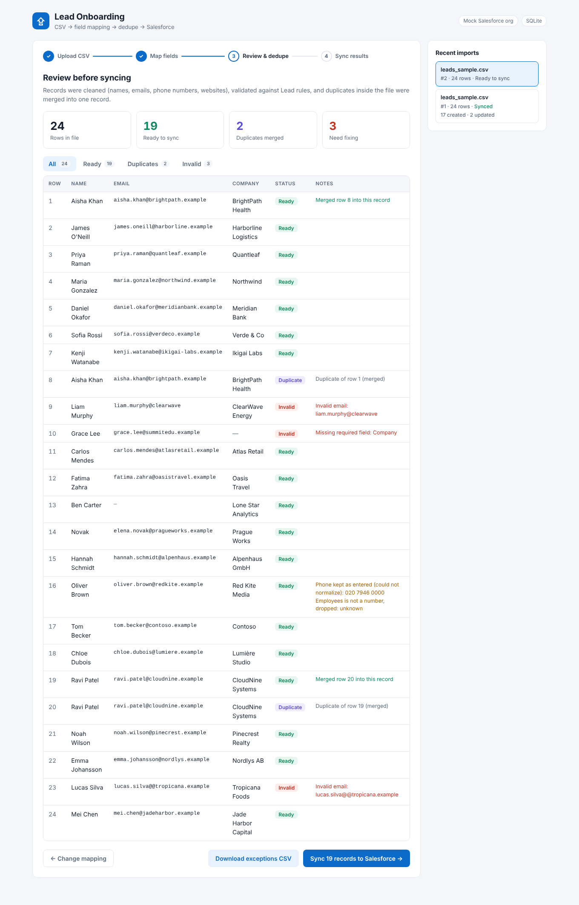
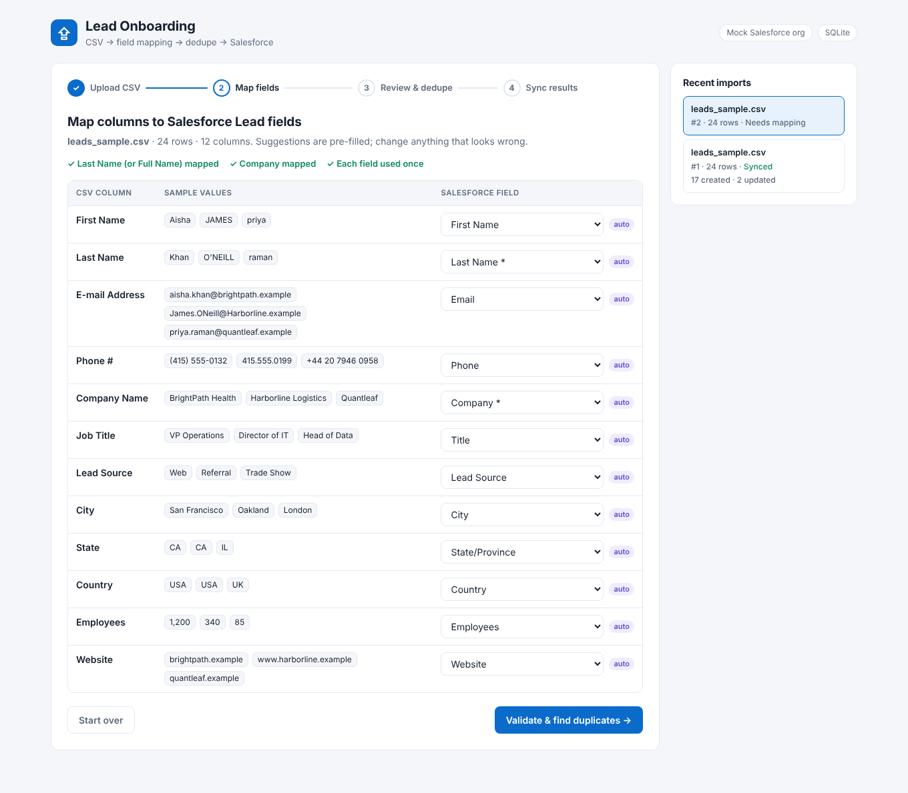
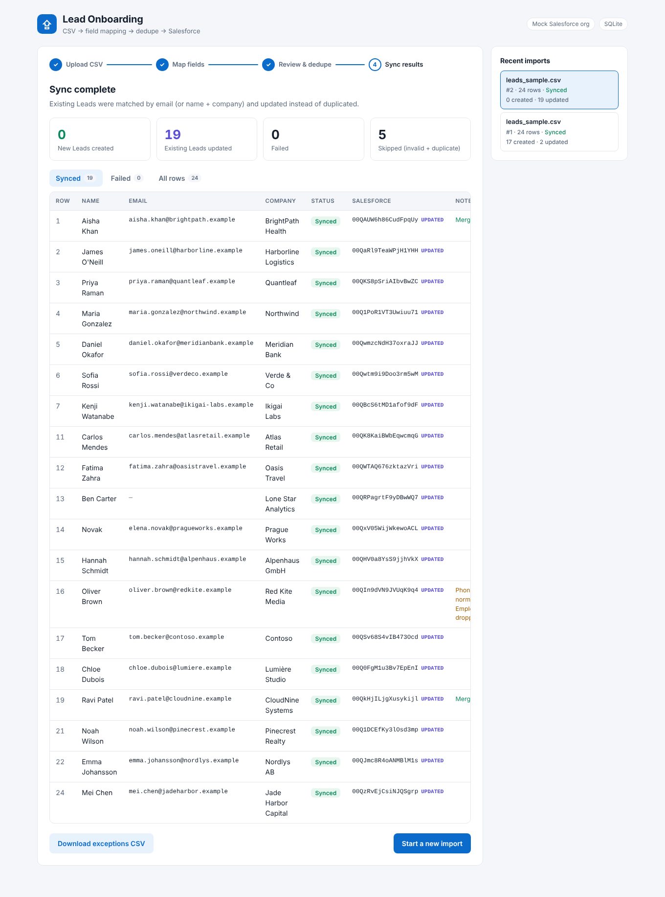
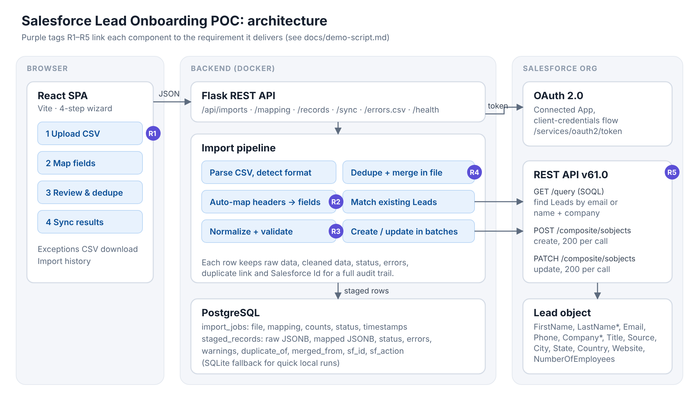

# Salesforce Lead Onboarding POC

Upload a messy CSV of leads, map its columns to Salesforce fields, clean and dedupe the records, and sync them to Salesforce through the REST API.

**Stack:** React (Vite) · Flask · PostgreSQL · Salesforce REST API · Docker



## What it does

| Step | What happens |
|---|---|
| **1. Upload** | Drag in any CSV. Encoding (UTF-8, Windows-1252) and delimiter (comma, semicolon, tab) are detected automatically. |
| **2. Map fields** | Columns are auto-matched to Lead fields (`E-mail Address` → `Email`, `Surname` → `LastName`, `Name` → split into first/last). You can change any of them. Required fields are checked before you continue. |
| **3. Review & dedupe** | Each row is normalized: name casing, lower-case emails, phones to E.164, `https://` on websites, `1,200` → `1200`. Rows are validated against Lead rules. Duplicates in the file are merged so no data is lost. Bad rows can be downloaded as an exceptions CSV. |
| **4. Sync** | Existing Leads are found with SOQL (by email, or by name + company), then updated; the rest are created. Writes use sObject Collections (200 per call). Every row records its Salesforce Id and whether it was created or updated. |

Running the same file twice updates the existing records and creates no duplicates.

| Map fields | Sync results |
|---|---|
|  |  |

## Evaluation: 100 records, 5 criteria

`backend/eval/` builds a fixed 100-row dataset with known answers and runs it through the whole pipeline. The rows include messy formatting, 10 duplicates, 10 invalid rows, 12 leads that already exist in Salesforce, and 4 leads with no email.

| # | Criterion | Result |
|---|---|---|
| 1 | Field mapping: every column auto-mapped correctly | ✅ 12/12 |
| 2 | Validation: exactly the bad rows rejected, each for the right reason | ✅ 100/100 |
| 3 | Dedupe & merge: duplicates caught, linked to the right row, missing fields filled | ✅ 100/100 |
| 4 | Sync accuracy: correct values in Salesforce, create vs update correct | ✅ 81/81 |
| 5 | Idempotency: re-running the same file creates zero new records | ✅ 3/3 |

Full report: [docs/eval-report.md](docs/eval-report.md). CI runs the evaluation against PostgreSQL on every push.

## Architecture



- **frontend/**: React single-page app, a four-step wizard plus import history
- **backend/app/**: Flask API (`routes.py`), import pipeline (`pipeline.py`), field definitions and auto-mapping (`fields.py`), cleaning and validation (`transform.py`), dedupe (`dedupe.py`), Salesforce client (`salesforce.py`)
- **PostgreSQL**: `import_jobs` and `staged_records` tables. Every row keeps its raw data, cleaned data, status, errors, duplicate link and Salesforce Id, which gives a full audit trail.

The customer demo script, which ties each requirement to its business value, is in [docs/demo-script.md](docs/demo-script.md).

## Run it

### Docker (app + PostgreSQL)

```bash
docker compose up --build
```

Open http://localhost:8000 and click **Use the sample file**.

### Local development

```bash
# API (uses SQLite if DATABASE_URL isn't set)
cd backend
python -m venv .venv && source .venv/bin/activate
pip install -r requirements-dev.txt
flask --app wsgi run --port 5000

# Front end, in a second terminal (proxies /api to :5000)
cd frontend
npm install
npm run dev
```

Open http://localhost:5173.

### Tests and evaluation

```bash
cd backend
pytest -q                                   # 33 tests
python -m eval.run_eval                     # 100 records, 5 criteria
TEST_DATABASE_URL=postgresql://... pytest   # run against PostgreSQL
```

## Connecting a real Salesforce org

With no credentials, the app uses a built-in **mock org**. It behaves like the real API for this flow: required-field errors, per-record results, and batching. The mock already contains two Leads, so you can see the update path.

To use a real org, such as a free Developer Edition or a sandbox:

1. **Setup → App Manager → New Connected App** (or an External Client App). Enable OAuth and the **Client Credentials Flow**, and add the `api` scope.
2. Under **Manage → Edit Policies**, set a **Run As** user, ideally a dedicated integration user.
3. Copy `.env.example` to `.env` and fill in `SF_DOMAIN_URL` (your My Domain URL), `SF_CLIENT_ID` and `SF_CLIENT_SECRET`.
4. Restart. The header badge changes to **Live Salesforce org**.

## API

| Method | Path | Purpose |
|---|---|---|
| `POST` | `/api/imports` | Upload a CSV (multipart `file`) → headers, preview, suggested mapping |
| `POST` | `/api/imports/sample` | Load the bundled sample file |
| `GET` | `/api/imports` · `/api/imports/:id` | Import history / one import |
| `PUT` | `/api/imports/:id/mapping` | Apply a mapping → normalize, validate, dedupe |
| `GET` | `/api/imports/:id/records?status=` | Paged rows (`valid`, `invalid`, `duplicate`, `synced`, `failed`) |
| `POST` | `/api/imports/:id/sync` | Push to Salesforce |
| `GET` | `/api/imports/:id/errors.csv` | Exceptions file |
| `GET` | `/api/salesforce/fields` · `/api/health` | Field list / status |

## Limits and next steps

- Built for the Lead object. Contacts or Accounts need their own field list and match rule.
- Capped at 10,000 rows per file. Larger loads should use the Bulk API 2.0.
- Fuzzy matching (e.g. "Jon" vs "John") and Salesforce Duplicate Rules are out of scope for the POC.

## License

MIT
